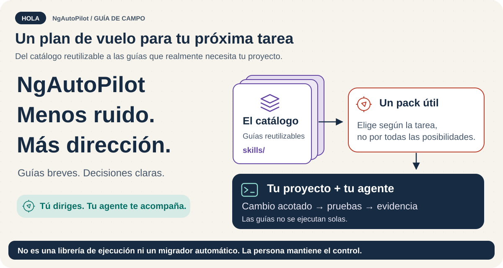
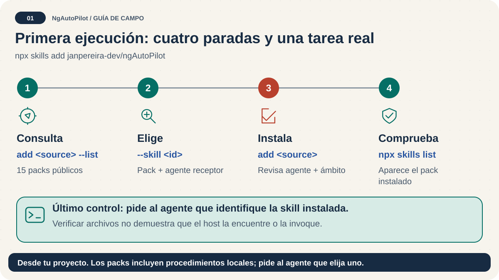
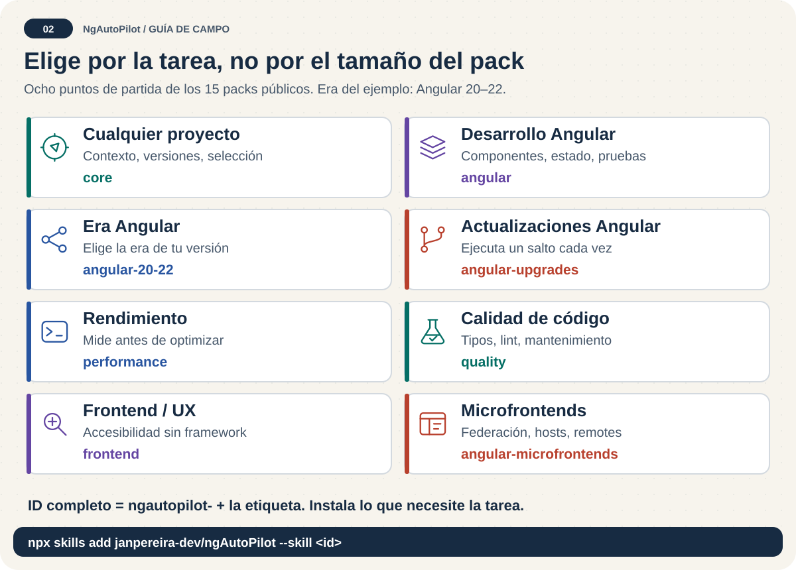
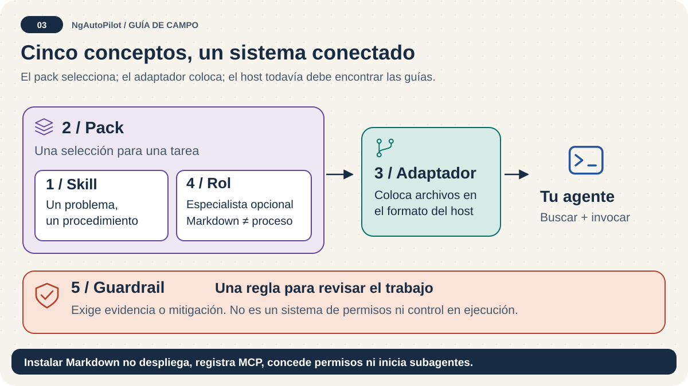
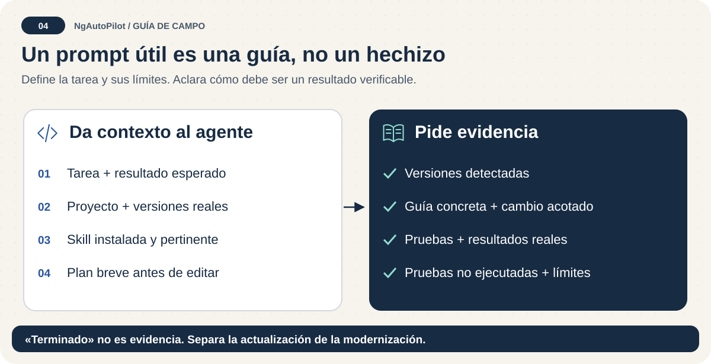
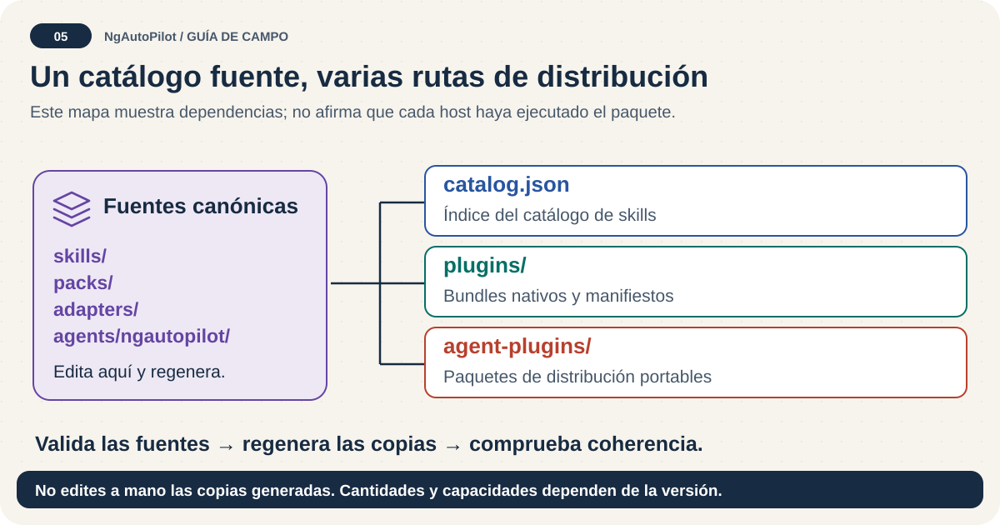
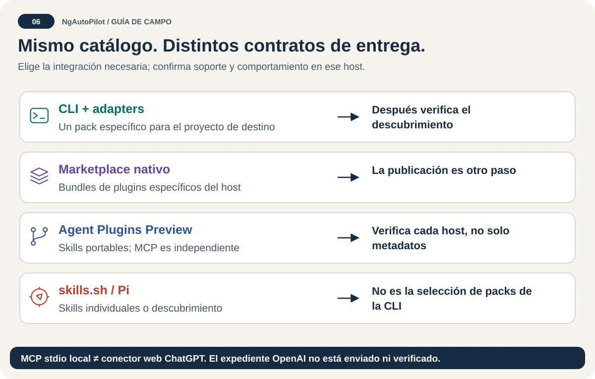
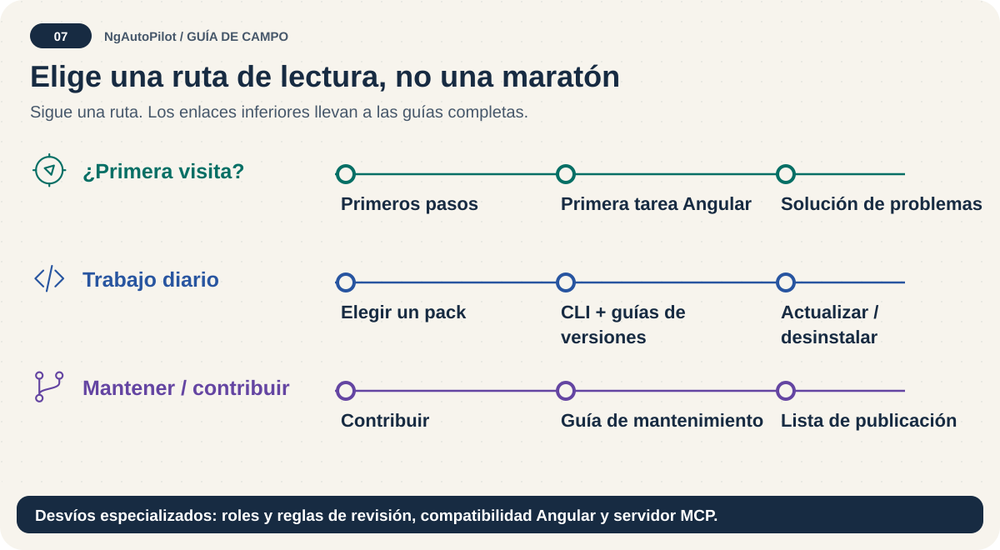
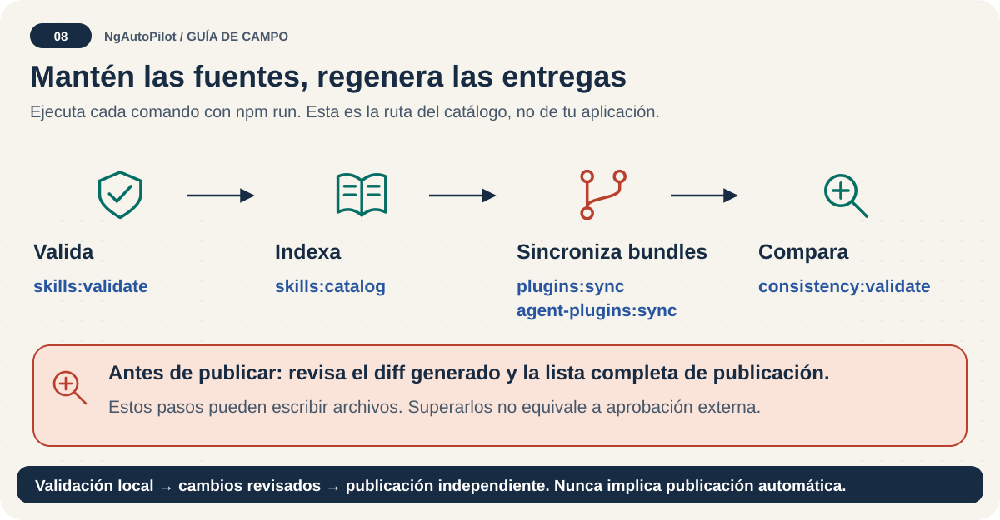

# NgAutoPilot 🚀

[English](README.md) · [Español](README.es.md) · [Mapa de documentación](docs/README.es.md)

**Dale a tu agente una ruta, no una montaña de instrucciones.**

NgAutoPilot es una herramienta de línea de comandos (CLI) y un catálogo de pequeñas guías de ingeniería (*skills*). Ayuda al agente a inspeccionar el proyecto, detectar versiones, elegir la guía adecuada, realizar un cambio acotado y validar el resultado. No es una biblioteca que se ejecute dentro de Angular ni un migrador automático de código.



## 🧭 Empieza aquí: un único comando



Solo necesitas **Node.js 22.20+**, npm y un proyecto existente. No hace falta instalar NgAutoPilot globalmente para el flujo recomendado.

Ejecuta **dentro del proyecto que quieres mejorar**:

```bash
npx skills add janpereira-dev/ngAutoPilot
```

Elige uno o varios de los 15 paquetes especializados. Cada paquete instala procedimientos canónicos completos como referencias Markdown locales, por lo que el agente puede utilizarlos sin instalar también la CLI de NgAutoPilot. Por ejemplo, para Angular:

```bash
npx skills add janpereira-dev/ngAutoPilot --skill ngautopilot-angular-20-22 -a codex
```

Para ver las opciones sin instalar, usa `npx skills add janpereira-dev/ngAutoPilot --list`. Para comprobar lo instalado, ejecuta `npx skills list`. Revisa el agente y el ámbito antes de confirmar; instalar instrucciones no modifica ni migra automáticamente tu aplicación.

**Siguiente paso:** [primera tarea Angular](docs/first-angular-project.es.md) · [instalación](docs/installation.es.md) · [solución de problemas](docs/troubleshooting.es.md).

## 📦 Las 15 opciones de instalación

Para el descubrimiento general, NgAutoPilot expone **15 gateway skills curadas** en lugar de colocar las 413 micro-skills canónicas en el selector interactivo:

```bash
# Interactivo: elige uno o varios gateways
npx skills add janpereira-dev/ngAutoPilot

# Ejemplos directos
npx skills add janpereira-dev/ngAutoPilot --skill ngautopilot-angular-20-22
npx skills add janpereira-dev/ngAutoPilot --skill ngautopilot-angular-upgrades
npx skills add janpereira-dev/ngAutoPilot --skill ngautopilot-full
```

| Gateway | Alcance |
| --- | --- |
| `ngautopilot-core` | Intake, detección de stack, routing, compatibilidad y riesgo |
| `ngautopilot-angular` | Gateway completo de capacidades Angular |
| `ngautopilot-angular-upgrades` | Todas las rutas acotadas de upgrade Angular |
| `ngautopilot-angular-microfrontends` | Hosts, remotes, federation, contratos y rollback |
| `ngautopilot-frontend` | UX, accesibilidad, responsive UI y design systems |
| `ngautopilot-performance` | Rendimiento y optimización Angular/frontend |
| `ngautopilot-quality` | Calidad más rutas seguras de TypeScript/JavaScript/CSS |
| `ngautopilot-angular-2-5` | Era Angular 2→4→5; Angular 3 nunca fue publicado |
| `ngautopilot-angular-6-8` | Workspace, RxJS 6, HttpClient y era pre-Ivy |
| `ngautopilot-angular-9-12` | Ivy, localize, testing, build y política de navegadores |
| `ngautopilot-angular-13-15` | Ivy-only, typed forms, inicio standalone y Material MDC |
| `ngautopilot-angular-16-17` | Signals, standalone, hydration, control flow y defer |
| `ngautopilot-angular-18-19` | Cambios runtime/testing y standalone por defecto |
| `ngautopilot-angular-20-22` | Zoneless, resources, Signal Forms, SSR y AI/MCP |
| `ngautopilot-full` | Gateway explícito para routing de todo el catálogo |

Los gateways reducen el selector **e incluyen los procedimientos canónicos completos como archivos locales**. La CLI propia es opcional para operaciones avanzadas (planes exactos, copias, actualizaciones gestionadas o MCP independiente).

## 🎒 Elige el pack para la tarea de hoy



| Tu tarea | Empieza con |
| --- | --- |
| Flujo básico, cualquier proyecto | `ngautopilot-core` |
| Arquitectura, componentes y servicios Angular | `ngautopilot-angular-foundations` |
| Signals y RxJS | `ngautopilot-angular-state` |
| Formularios, rutas, plantillas y Material | `ngautopilot-angular-ui` |
| SSR, compilación, rendimiento y seguridad | `ngautopilot-angular-runtime` |
| Pruebas Angular | `ngautopilot-angular-testing` |
| Accesibilidad y UX independientes del framework | `ngautopilot-frontend` |
| Un único salto de versión mayor Angular | `ngautopilot-angular-<from>-to-<to>` |

Los packs específicos incluyen Core mediante dependencias. Cambiar de pack para el mismo agente y ámbito **sustituye la selección gestionada**, en lugar de acumular todos los packs anteriores. Los archivos gestionados obsoletos sin cambios pueden eliminarse; los obsoletos modificados se conservan y notifican salvo que se fuerce. Los archivos todavía seleccionados se conservan si están editados salvo autorización explícita con `--force`. Guarda tus personalizaciones e inspecciona cada cambio.

`ngautopilot-angular` y `ngautopilot-full` son opciones amplias deliberadas, no recomendaciones para principiantes. [Packs y saltos históricos](docs/packs.es.md).

## 🧩 Cinco conceptos útiles



| Concepto | Significado sencillo |
| --- | --- |
| Skill | Procedimiento para un problema de ingeniería |
| Pack | Selección de skills y recursos especializados opcionales |
| Adaptador | Distribución de archivos para tu agente |
| Rol de subagente | Definición Markdown de un especialista; no es un agente en ejecución |
| Guardrail | Regla de revisión que exige evidencia o mitigación; no impone controles durante la ejecución |

```text
Tu tarea → inspeccionar → detectar versiones → elegir guía → revisar riesgos
         → realizar un cambio pequeño → validar → comunicar evidencias
```



La animación decorativa dura 3,6 segundos, se reproduce una vez y respeta la preferencia de movimiento reducido. Todos los pasos siguen siendo legibles en una vista estática.

La persona dirige la tarea. Las skills orientan al agente. Las pruebas y la revisión demuestran el resultado. Instalar Markdown no concede permisos, despliega servicios, registra MCP ni inicia subagentes automáticamente.

## 💬 Prueba un mensaje útil



> Inspecciona las versiones de Angular, Node, TypeScript y RxJS del proyecto. Identifica la skill de NgAutoPilot instalada para rutas con carga diferida. Explica el cambio seguro más pequeño antes de editar y valida con las comprobaciones existentes del proyecto. Indica qué comprobaciones no pudiste ejecutar.

Para revisar pruebas, cambia la tarea por «revisar configuraciones frágiles de TestBed y comportamiento asíncrono». Para actualizar Angular, indica la versión actual y la siguiente, y separa la modernización.

**Un buen resultado incluye:** versiones detectadas, una skill aplicable identificada, un plan acotado y resultados reales de validación; no solo «terminado».

## 🔎 Catálogo y mapa del repositorio



Tamaño actual del catálogo: **413 skills**.

En este checkout, `doctor` muestra **36 packs y 10 adaptadores**. Ejecuta `doctor`, `packs` y `adapters` para tu versión instalada, en lugar de suponer que todas las versiones coinciden.

| Fuente | Responsabilidad |
| --- | --- |
| `skills/_core/` | Recepción, detección, selección, compatibilidad y riesgo |
| `skills/angular/versioning/` | Decisiones según la versión |
| `skills/angular/upgrades/` | Saltos de versión, incluido `skills/angular/upgrades/21-to-22/` |
| `skills/angular/modernization/` | Standalone, flujo de control, `@defer` y adopción zoneless después de estabilizar |
| `skills/angular/architecture/` | Límites y patrones de la aplicación |
| `skills/angular/microfrontends/` | Límites distribuidos del frontend |
| `skills/angular/docs/` | Decisiones arquitectónicas, informes y paquetes de revisión |
| `skills/frontend/`, `skills/css/` | Accesibilidad, UX, diseño, distribución visual y rendimiento |
| `skills/typescript/`, `skills/javascript/`, `skills/quality/` | Procedimientos transversales de lenguaje y calidad |

`skills/` es la fuente canónica. `catalog.json`, `plugins/` y `agent-plugins/` son distribuciones generadas; no edites sus copias manualmente. [Arquitectura](docs/ecosystem-architecture.es.md).

## 🛤️ Elige la distribución adecuada



| Ruta | Qué hace | Qué no demuestra |
| --- | --- | --- |
| CLI de NgAutoPilot | Packs específicos o perfiles Angular compatibles | Descubrimiento o ejecución en el cliente |
| `npx skills add janpereira-dev/ngAutoPilot` | 15 paquetes con procedimientos canónicos locales | No modifica código ni registra MCP automáticamente |
| Manifiestos Claude/Codex | Descripciones de bundles nativos | Publicación, aprobación o compatibilidad universal |
| Agent Plugins Preview | Skills portables y MCP stdio separado de solo lectura | Instalación completa en todos los clientes |
| Metadatos Pi | La misma superficie curada de gateways desde el paquete npm | Comportamiento verificado del cliente en ejecución |

Identificadores: `claude`, `codex`, `copilot`, `cursor`, `gemini`, `generic`, `hermes`, `openclaw`, `opencode`, `pi`. Nativo, adaptado, experimental y no verificado son estados distintos. [Matriz de instalación](docs/agent-installation-matrix.es.md).

El expediente OpenAI de esta rama contiene **solo skills**, **no se ha enviado** y **no está verificado por OpenAI**. Las declaraciones humanas siguen siendo acciones humanas. Ejecuta `npm run openai:validate` y `npm run openai:pack` para el paquete actual. [Límites de publicación](docs/openai-marketplace-release.es.md).

## 📚 Elige el siguiente capítulo



| Quieres… | Consulta |
| --- | --- |
| Empezar sin conocer la terminología | [Primeros pasos](docs/getting-started.es.md) |
| Seguir un ejemplo de principio a fin | [Primer proyecto Angular](docs/first-angular-project.es.md) |
| Instalar, cambiar de pack, exportar o trabajar sin conexión | [Instalación](docs/installation.es.md) |
| Encontrar un comando exacto | [Referencia CLI](docs/cli-reference.es.md) |
| Entender la cobertura Angular | [Versiones](docs/angular-version-support.es.md), [mapa por etapas](docs/angular-version-era-map.es.md) |
| Mantener los archivos instalados | [Actualización](docs/updating.es.md), [desinstalación](docs/uninstalling.es.md) |
| Entender roles y reglas | [Roles](docs/agents-and-subagents.es.md), [prompts y guardrails](docs/prompts-and-guardrails.es.md) |
| Registrar el servidor MCP separado | [MCP y ChatGPT](docs/mcp-and-chatgpt.es.md) |
| Contribuir o publicar | [Contribución](CONTRIBUTING.es.md), [mantenimiento](docs/maintainer-guide.es.md), [lista de publicación](docs/release-checklist.es.md) |

**Todas las guías, registros históricos y estado de traducción:** [mapa en inglés](docs/README.md) · [mapa en español](docs/README.es.md).

## 🛠️ Punto de control para mantenimiento



Los cambios del catálogo usan el flujo existente:

```bash
npm run skills:validate
npm run skills:catalog
npm run plugins:sync
npm run agent-plugins:sync
npm run npx-skills:sync
npm run npx-skills:validate
npm run consistency:validate
```

La [lista de publicación](docs/release-checklist.es.md) cubre la validación y el empaquetado completos. Estos comandos pueden regenerar archivos: revisa los cambios. Las comprobaciones locales no demuestran publicación ni aprobación de revisión.

## Licencia y comunidad

MIT · [Licencia](LICENSE) · [Avisos de seguridad](SECURITY.es.md) · [Código de conducta](CODE_OF_CONDUCT.es.md) · [Historial](CHANGELOG.es.md) · [Hoja de ruta](ROADMAP.es.md)

## Ruta de release y publicación

[Tareas de release y publicación 0.10.0](docs/publication-plan.es.md) · [Plataforma](docs/capability-platform.es.md) · [Exportaciones nativas](docs/adapter-maintenance.es.md) · [Transiciones seguras](docs/pack-transitions.es.md)
