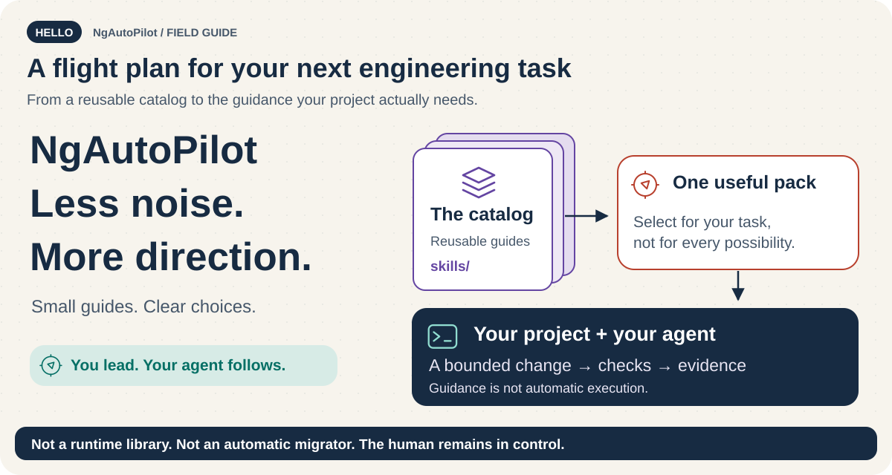
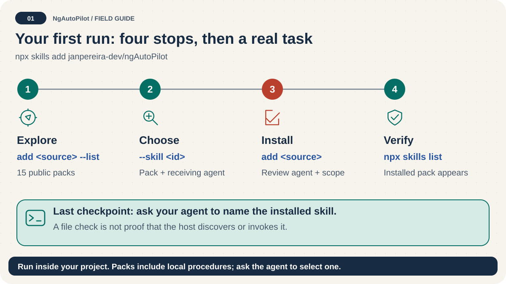
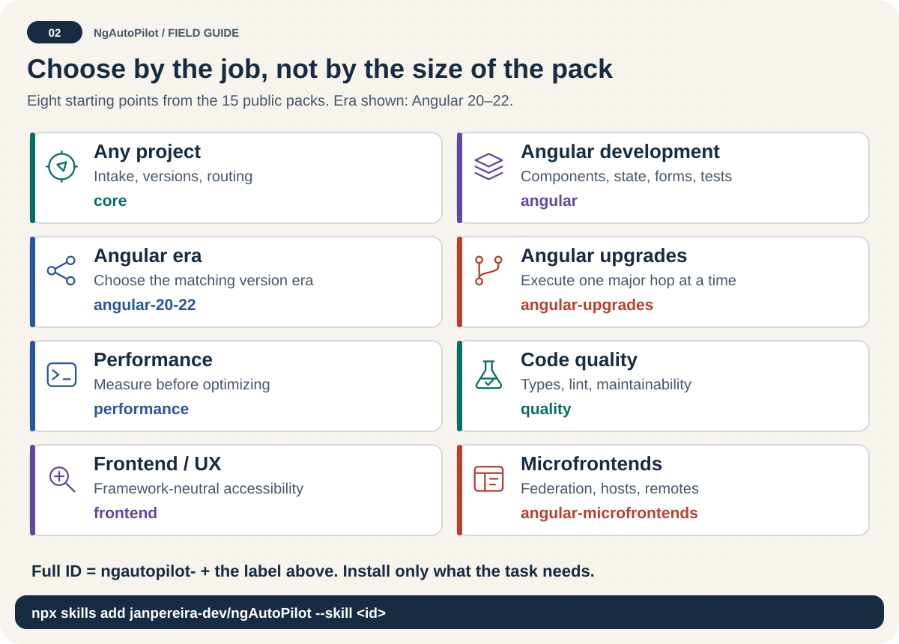
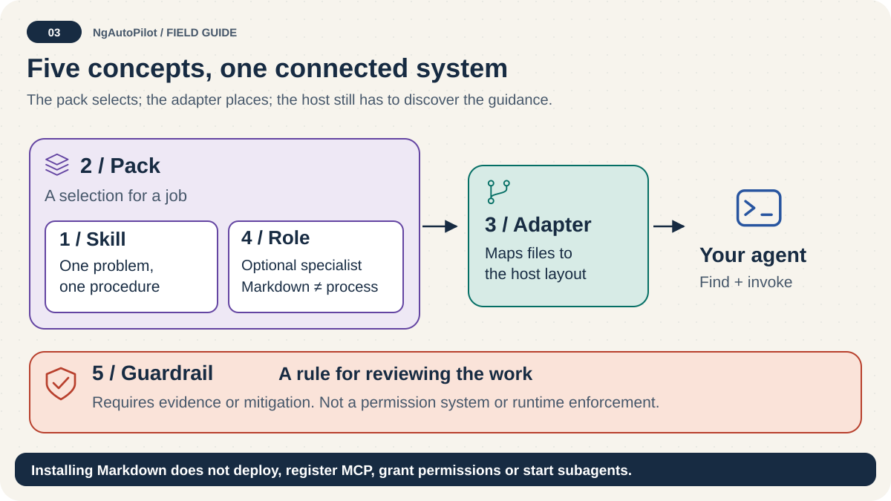
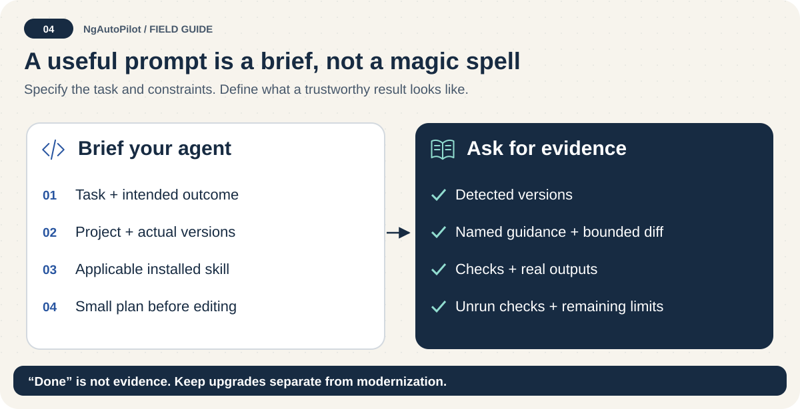
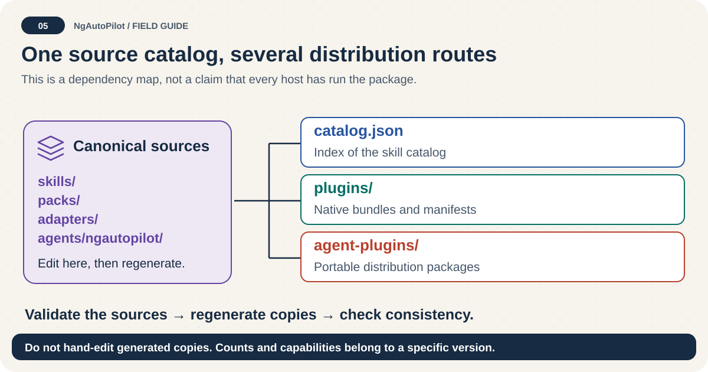
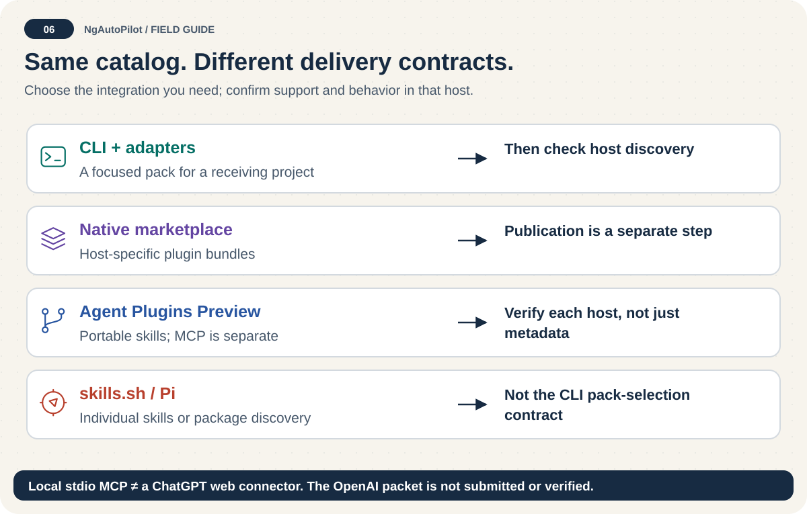
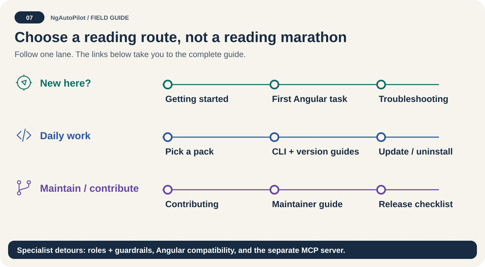
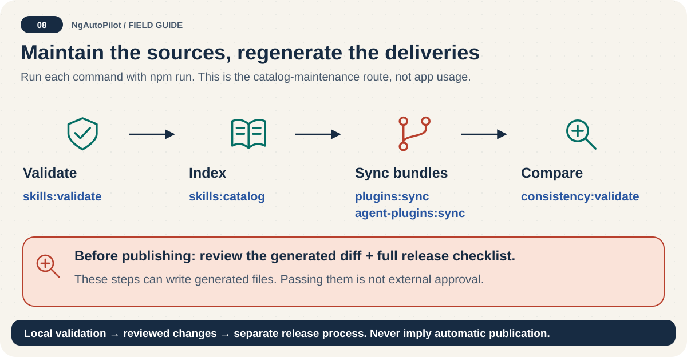

# NgAutoPilot 🚀

[English](README.md) · [Español](README.es.md) · [Documentation map](docs/README.md)

**Give your coding agent a route, not a pile of instructions.**

NgAutoPilot is a CLI and a catalog of small engineering guides (*skills*). It helps an agent inspect your project, detect versions, choose relevant guidance, make a bounded change, and validate the result. It is not an Angular runtime library or an automatic code migrator.



## 🧭 Start here: one command



You only need **Node.js 22.20+**, npm and an existing project. No global NgAutoPilot installation is required for the recommended workflow.

Run **inside the project you want to improve**:

```bash
npx skills add janpereira-dev/ngAutoPilot
```

Choose one or more of the 15 focused bundles. Each choice installs full canonical procedures as local Markdown references, so your agent can read them without installing the NgAutoPilot CLI. For a direct Angular example:

```bash
npx skills add janpereira-dev/ngAutoPilot --skill ngautopilot-angular-20-22 -a codex
```

To inspect before installing, run `npx skills add janpereira-dev/ngAutoPilot --list`. To check installed entries, use `npx skills list`. Review the selected agent and installation scope before confirming; installing instructions does not edit or automatically migrate your app.

**Next:** [first Angular task](docs/first-angular-project.md) · [installation](docs/installation.md) · [troubleshooting](docs/troubleshooting.md).

## 📦 The 15 install choices

For broad discovery, NgAutoPilot exposes **15 curated gateway skills** instead of placing all 413 canonical micro-skills in the interactive selector:

```bash
# Interactive: choose one or more curated gateways
npx skills add janpereira-dev/ngAutoPilot

# Direct examples
npx skills add janpereira-dev/ngAutoPilot --skill ngautopilot-angular-20-22
npx skills add janpereira-dev/ngAutoPilot --skill ngautopilot-angular-upgrades
npx skills add janpereira-dev/ngAutoPilot --skill ngautopilot-full
```

| Gateway | Scope |
| --- | --- |
| `ngautopilot-core` | Intake, stack detection, routing, compatibility, risk |
| `ngautopilot-angular` | Complete Angular capability gateway |
| `ngautopilot-angular-upgrades` | All bounded Angular upgrade routes |
| `ngautopilot-angular-microfrontends` | Hosts, remotes, federation, contracts, rollback |
| `ngautopilot-frontend` | UX, accessibility, responsive UI, design systems |
| `ngautopilot-performance` | Angular/frontend performance and optimization |
| `ngautopilot-quality` | Quality plus TypeScript/JavaScript/CSS safety routes |
| `ngautopilot-angular-2-5` | Angular 2→4→5 legacy era; Angular 3 was never released |
| `ngautopilot-angular-6-8` | Workspace, RxJS 6, HttpClient, pre-Ivy era |
| `ngautopilot-angular-9-12` | Ivy, localize, testing, build and browser-policy era |
| `ngautopilot-angular-13-15` | Ivy-only, typed forms, standalone start, Material MDC |
| `ngautopilot-angular-16-17` | Signals, standalone, hydration, control flow, defer |
| `ngautopilot-angular-18-19` | Runtime/testing changes and standalone-by-default |
| `ngautopilot-angular-20-22` | Zoneless, resources, Signal Forms, SSR, AI/MCP |
| `ngautopilot-full` | Explicit all-in routing gateway |

The gateways keep discovery small **and include the canonical procedure bodies locally**. Use the native CLI only for advanced operations (exact hop plans, backups, managed updates or the separate MCP). This avoids a 400-item picker without losing useful technical detail.

## 🎒 Pick the pack for today's job



| Your task | Start with |
| --- | --- |
| Basic workflow, any project | `ngautopilot-core` |
| Angular architecture, components, forms, state, tests | `ngautopilot-angular` |
| Guidance for an Angular era | An era pack, e.g. `ngautopilot-angular-20-22` |
| Angular upgrade guidance | `ngautopilot-angular-upgrades` |
| Measured rendering and web performance | `ngautopilot-performance` |
| Language safety and code quality | `ngautopilot-quality` |
| Framework-neutral accessibility and UX | `ngautopilot-frontend` |
| Federation, hosts and remotes | `ngautopilot-angular-microfrontends` |

Every ID in this table works with `npx skills add janpereira-dev/ngAutoPilot --skill <id>`. You can install multiple public packs together. For upgrades, open only the procedure for the next supported major hop.

The optional native CLI has additional granular packs such as `ngautopilot-angular-foundations` and `ngautopilot-angular-17-to-18`. Those IDs belong to `ngautopilot install --pack`, not to the 15-option `npx skills` selector. Its managed selection and pack-switching rules are described in [advanced native pack installation](docs/packs.md#advanced-native-pack-installation). Use `ngautopilot-full` only when you need the entire catalog.

## 🧩 Five useful concepts



| Concept | Plain meaning |
| --- | --- |
| Skill | A procedure for one engineering problem |
| Pack | A selection of skills and optional specialist assets |
| Adapter | The installation layout for your agent |
| Subagent role | A Markdown specialist definition; not a running agent by itself |
| Guardrail | A review rule requiring evidence or mitigation; not runtime enforcement |

```text
Your task → inspect → detect versions → select guidance → check risks
         → make a small change → validate → report evidence
```


The decorative animation runs once for 3.6 seconds and respects reduced motion. All steps remain readable in a static preview.

The human directs the task. Skills guide the agent. Tests and review prove the result. Installing Markdown does not grant permissions, deploy services, register MCP, or automatically start subagents.

## 💬 Try a useful prompt



> Inspect this project's Angular, Node, TypeScript, and RxJS versions. Identify the installed NgAutoPilot skill for lazy-loaded routes. Explain the smallest safe change before editing, then validate using the project's existing checks. Report checks you could not run.

For test review, substitute “review fragile TestBed setup and asynchronous behavior.” For upgrades, name the current and next major version and keep modernization separate.

**Success means:** detected versions, a named applicable skill, a bounded plan, and real validation output—not just “done.”

## 🔎 Catalog and repository map



Current catalog size: **413 skills**

This checkout's `doctor` reports **36 packs and 10 adapters**. Run `doctor`, `packs`, and `adapters` for your installed version instead of assuming every release matches.

| Source | Responsibility |
| --- | --- |
| `skills/_core/` | Intake, detection, routing, compatibility, risk |
| `skills/angular/versioning/` | Version-aware decisions |
| `skills/angular/upgrades/` | Major hops, including `skills/angular/upgrades/21-to-22/` |
| `skills/angular/modernization/` | Standalone, control flow, `@defer`, zoneless adoption after stability |
| `skills/angular/architecture/` | Application boundaries and patterns |
| `skills/angular/microfrontends/` | Distributed frontend boundaries |
| `skills/angular/docs/` | ADRs, upgrade reports, review packets |
| `skills/frontend/`, `skills/css/` | Accessibility, UX, design, layout, performance |
| `skills/typescript/`, `skills/javascript/`, `skills/quality/` | Cross-cutting language and quality procedures |

`skills/` remains canonical. `skills/SKILL.md` is an internal discovery boundary, while `.agents/skills/` is the generated 15-gateway public surface for broad discovery. `catalog.json`, `plugins/`, and `agent-plugins/` are generated distributions; do not hand-edit their copies. [Architecture](docs/ecosystem-architecture.md).

## 🛤️ Choose the right distribution



| Route | What it does | What it does not prove |
| --- | --- | --- |
| NgAutoPilot CLI | Focused packs or supported Angular profiles | Host discovery or invocation |
| `npx skills add janpereira-dev/ngAutoPilot` | 15 curated bundles with local canonical procedures | No automatic source edits or MCP registration |
| Claude/Codex marketplace manifests | Native bundle descriptions | Publication, approval, universal compatibility |
| Agent Plugins Preview | Portable skills plus separate read-only stdio MCP | End-to-end installation in every host |
| Pi metadata | The same curated gateway surface from the npm package | Verified host runtime behavior |

Adapter IDs: `claude`, `codex`, `copilot`, `cursor`, `gemini`, `generic`, `hermes`, `openclaw`, `opencode`, `pi`. Native, adapter, experimental, and unverified are different statuses. [Installation matrix](docs/agent-installation-matrix.md).

The OpenAI packet in this branch is **skills-only**, **not submitted**, and **not OpenAI verified**. Human attestations remain human actions. Run `npm run openai:validate` and `npm run openai:pack` for the current skills-only package. [Release boundary](docs/openai-marketplace-release.md).

## 📚 Choose your next chapter



| You want to… | Read |
| --- | --- |
| Start without knowing the terminology | [Getting started](docs/getting-started.md) |
| Follow a complete first-use example | [First Angular project](docs/first-angular-project.md) |
| Install, switch, export, or work offline | [Installation](docs/installation.md) |
| Find an exact command | [CLI reference](docs/cli-reference.md) |
| Understand Angular guidance | [Version support](docs/angular-version-support.md), [era map](docs/angular-version-era-map.md) |
| Maintain installed files | [Updating](docs/updating.md), [uninstalling](docs/uninstalling.md) |
| Understand roles and review rules | [Roles](docs/agents-and-subagents.md), [prompts and guardrails](docs/prompts-and-guardrails.md) |
| Register the separate MCP server | [MCP and ChatGPT](docs/mcp-and-chatgpt.md) |
| Contribute or release | [Contributing](CONTRIBUTING.md), [maintainer guide](docs/maintainer-guide.md), [release checklist](docs/release-checklist.md) |

**All guides, historical records, and translation status:** [English map](docs/README.md) · [Mapa en español](docs/README.es.md).

## 🛠️ Maintainer checkpoint



For catalog changes, use the existing source pipeline:

```bash
npm run skills:validate
npm run skills:catalog
npm run plugins:sync
npm run agent-plugins:sync
npm run npx-skills:sync
npm run npx-skills:validate
npm run consistency:validate
```

The [release checklist](docs/release-checklist.md) covers the full validation and packaging procedure. These commands can regenerate files: inspect the diff. Local checks do not prove publication or review approval.

## License and community

MIT · [License](LICENSE) · [Security reporting](SECURITY.md) · [Code of conduct](CODE_OF_CONDUCT.md) · [Changelog](CHANGELOG.md) · [Roadmap](ROADMAP.md)

## Release and publication roadmap

[0.11.0 release and publication tasks](docs/publication-plan.md) · [Capability platform](docs/capability-platform.md) · [Native exports](docs/adapter-maintenance.md) · [Safe pack transitions](docs/pack-transitions.md)
